<head>
  <link rel="canonical" href="https://docs.harvesterhci.io/v1.9/advanced/addons/lvm-local-storage"/>
</head>

:::note

The **harvester-csi-driver-lvm** add-on is generally available (GA) starting with Harvester v1.9.1. Volumes created with pre-GA versions are incompatible with the GA driver and are not supported.

The add-on is classified as *experimental* in Harvester v1.9.0. For information about feature maturity, see [Feature Labels](../../getting-started/document-conventions.md#feature-labels).

This add-on is not included in the Harvester ISO, but you can download the manifest (`harvester-csi-driver-lvm-addon.yaml`) from the [Harvester **Releases** page](https://github.com/harvester/harvester/releases). Manifest source files are located in the `addons/standalone` directory of the [Harvester repository](https://github.com/harvester/harvester/tree/master/addons/standalone).

:::

Harvester allows you to use local storage on the host to create persistent volumes for your workloads with better performance and latency. This functionality is made possible by LVM, which provides logical volume management facilities on Linux.

The **harvester-csi-driver-lvm** add-on is a CSI driver that supports local path provisioning through LVM.

## Supported Configuration

The driver provisions node-local LVM volumes. The volumes and the workloads that use them must be on the same node.

- Use the `ReadWriteOnce` access mode. Multi-node `ReadWriteMany` (RWX) access is not supported. Pre-GA versions accepted RWX volumes, but those volumes did not provide true multi-node RWX semantics.
- Use the `dm-thin` volume type. This is the only volume type included in the GA support scope.
- Use the `Immediate` volume binding mode (`volumeBindingMode: Immediate`).
- Virtual machine live migration is not supported for VMs that use LVM volumes.

The `striped` volume type is deprecated and outside the GA support scope. Striped volumes do not provide the storage-efficient snapshot, clone, and restore behavior required by the supported CSI workflow. These operations require full data copies, which increase capacity and I/O requirements and can cause longer operations, retries, and timeouts.

## Upgrading from a Pre-GA Release

:::caution

Before upgrading the add-on to the GA version provided in Harvester v1.9.1 or later, back up all critical data and delete every LVM volume created with a pre-GA driver release. Pre-GA volumes are incompatible with the GA driver and cannot be recovered after upgrading.

:::

## Installing and Enabling the Add-on

If you are using the Harvester kubeconfig file, you can install the add-on by performing the following steps:

1. Install the add-on by running the following command:

    ```
    kubectl apply -f https://github.com/harvester/harvester/releases/download/<version>/harvester-csi-driver-lvm-addon.yaml
    ```

    Replace `<version>` with the version of your Harvester cluster (for example, `v1.10.0`).

1. On the Harvester UI, go to **Advanced** > **Add-ons**.

1. Select **harvester-csi-driver-lvm**, and then select **⋮** > **Enable**.

## Creating a Volume Group for LVM

A volume group combines physical volumes to create a single storage structure that can be divided into logical volumes.

:::note

Harvester currently does not allow you to modify the volume group composition (add or remove disks) after you create a logical volume. This issue will be addressed in a future release.

:::

When the driver provisions the first `dm-thin` volume in a volume group, it automatically creates `<volume-group>-thinpool` if that pool does not already exist. The driver applies the following creation policy:

- **Data capacity**: 90% of currently free volume group extents for thin-pool data
- **Chunk size**: 512 KiB
- **Active metadata**: 16 GiB
- **Metadata repair spare**: An enabled LVM repair spare approximately equal in size to the active metadata (~16 GiB)

The driver reserves approximately 32 GiB of total volume group capacity for active metadata and the repair spare. The repair spare provides redundancy for recovery operations and does not increase live metadata capacity. Ensure the volume group has sufficient free capacity to satisfy the data pool, active metadata, and repair spare allocations. Thin-pool creation fails if available space is insufficient.

The 16 GiB metadata allocation reduces the risk of metadata exhaustion but does not eliminate it.

:::note

If `<volume-group>-thinpool` already exists, the driver uses the pool as-is without modifying its geometry. Reusing an existing thin pool does not provide backward compatibility for volumes provisioned by pre-GA driver versions.

:::

1. Verify that the **harvester-csi-driver-lvm** add-on is installed.

1. On the Harvester UI, go to the **Hosts** screen.

1. Select the target host, and then select **⋮** > **Edit Config**.

1. On the Storage tab, add disks for the volume group.

    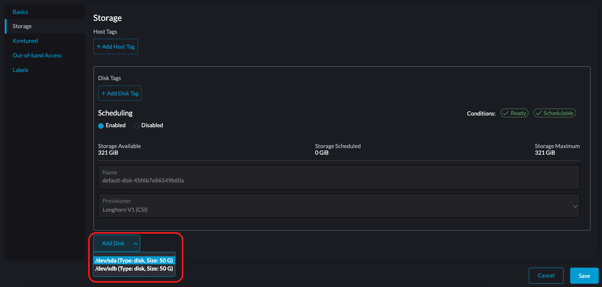

    Configure the following settings for each selected disk:

    - **Provisioner**: Select **LVM**.

      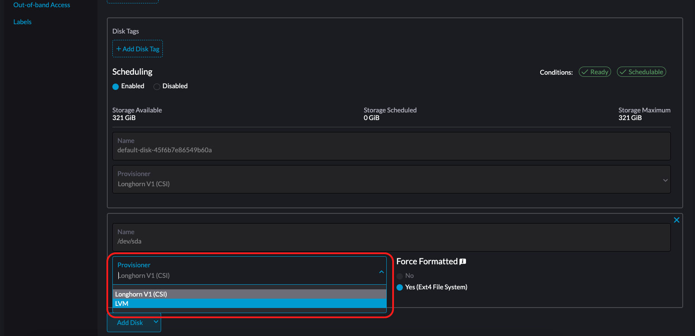

    - **Volume Group**: Select an existing volume group or specify a name for a new volume group.

      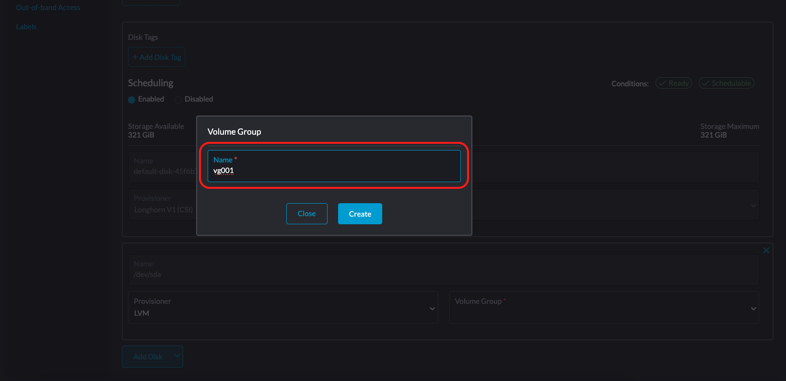

    For more information about adding disks, see [Multi-Disk Management](../../host/#multi-disk-management).

1. Click **Save**.

1. On the host details screen, verify that the disks were added and the correct provisioner was set.

    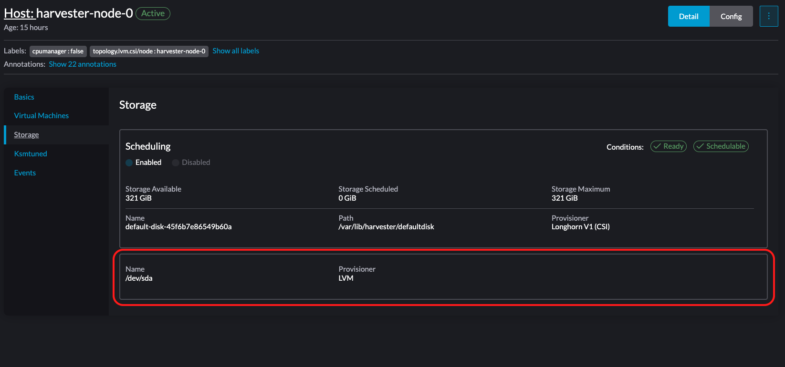

## Creating a StorageClass for LVM

:::note

Use only the `dm-thin` volume type. The `striped` volume type is deprecated and excluded from the GA support scope.

:::

1. On the Harvester UI, go to the **Storage** screen.

1. Create a new StorageClass and select **LVM** in the **Provisioner** list.

    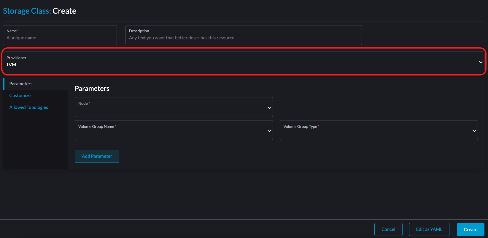

1. On the **Parameters** tab, configure the following settings:

    - **Node**: Select the target node for the intended workloads. 
  
      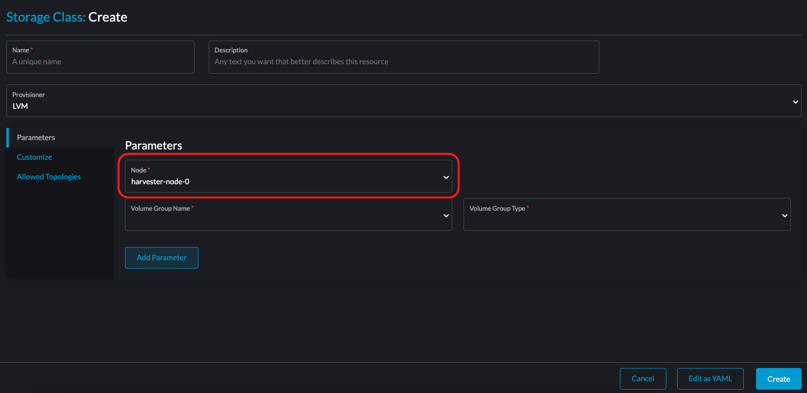

    - **Volume Group Name**: Select the volume group that you created.

      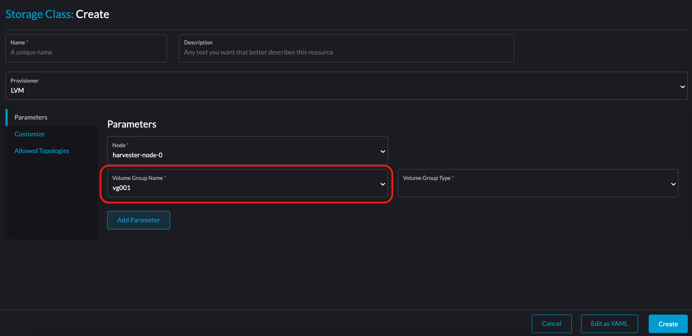

    - **Volume Group Type**: Select **dm-thin**.

    - **Volume Mode / Access Modes**: On the **CDI Settings** tab, verify that the volume mode is **Block** and the access mode is **ReadWriteOnce**. For more information, see [Containerized Data Importer (CDI) Settings](../storageclass.md#containerized-data-importer-cdi-settings).

1. Select **Edit YAML** and set `volumeBindingMode: Immediate` before saving the StorageClass.

1. Click **Save**.

1. On the **Storage** screen, verify that the StorageClass was created and the correct provisioner was set.

    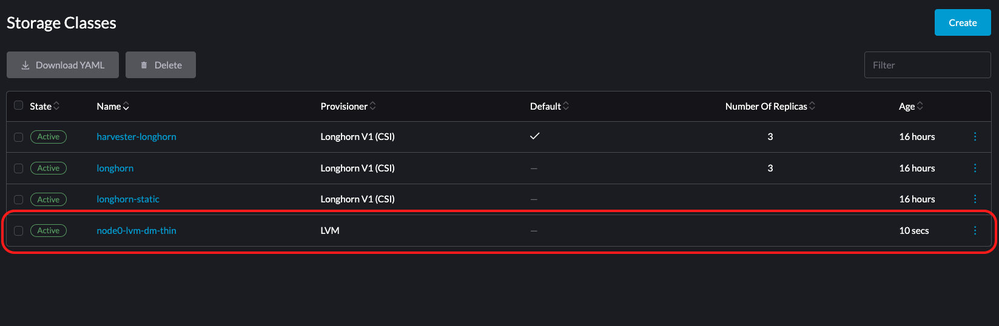

For more information, see [StorageClass](../storageclass.md).

## Encrypting an LVM Volume

`dm-thin` LVM volumes can be encrypted at rest using LUKS2 (dm-crypt). Encryption is configured on the StorageClass, and it uses the same encryption secret convention as [Longhorn volume encryption](../../rancher/csi-driver/longhorn.md), so any volume, VM image, or virtual machine that uses an encrypted StorageClass is encrypted automatically.

:::note

Encryption is an opt-in property of the StorageClass. Existing (unencrypted) StorageClasses are unaffected, and you cannot convert a volume between the encrypted and unencrypted states.

:::

### Creating an Encryption Secret

Create a `Secret` that holds the encryption passphrase in the `CRYPTO_KEY_VALUE` field. Include all of the fields shown below: the CSI driver applies the defaults `aes-xts-plain64` / `sha256` / `256` / `argon2i` when the tuning fields are omitted, but Harvester rejects a StorageClass whose encryption secret has a missing or empty field.

The secret must exist before you create the StorageClass that references it.

```yaml
apiVersion: v1
kind: Secret
metadata:
  name: lvm-encryption
  namespace: default
type: Opaque
stringData:
  CRYPTO_KEY_VALUE: "Your encryption passphrase"
  CRYPTO_KEY_PROVIDER: "secret"
  CRYPTO_KEY_CIPHER: "aes-xts-plain64"
  CRYPTO_KEY_HASH: "sha256"
  CRYPTO_KEY_SIZE: "256"
  CRYPTO_PBKDF: "argon2i"
```

:::caution

Store the passphrase securely and back it up. If the secret is lost, the encrypted data is **unrecoverable**.

:::

### Creating an Encrypted StorageClass

1. On the Harvester UI, go to the **Storage** screen.

1. Create a new StorageClass, select **LVM** in the **Provisioner** list, and configure the **Node**, **Volume Group Name**, and **Volume Group Type** (`dm-thin`) as described in [Creating a StorageClass for LVM](#creating-a-storageclass-for-lvm).

1. On the **Parameters** tab, set **Volume Encryption** to **Yes**, and then select the encryption secret that you created.

1. Click **Save**.

You can also create the encrypted StorageClass directly. The `encrypted: "true"` parameter and the `csi.storage.k8s.io/*-secret-*` parameters that reference the encryption secret are required.

```yaml
apiVersion: storage.k8s.io/v1
kind: StorageClass
metadata:
  name: lvm-dm-thin-encrypted
  annotations:
    # Use host-assisted copy so image clones are written through the encryption
    # layer. See the note below.
    cdi.harvesterhci.io/storageProfileCloneStrategy: copy
parameters:
  type: dm-thin
  vgName: <your-volume-group>
  encrypted: "true"
  csi.storage.k8s.io/provisioner-secret-name: lvm-encryption
  csi.storage.k8s.io/provisioner-secret-namespace: default
  csi.storage.k8s.io/node-publish-secret-name: lvm-encryption
  csi.storage.k8s.io/node-publish-secret-namespace: default
  csi.storage.k8s.io/node-stage-secret-name: lvm-encryption
  csi.storage.k8s.io/node-stage-secret-namespace: default
  csi.storage.k8s.io/node-expand-secret-name: lvm-encryption
  csi.storage.k8s.io/node-expand-secret-namespace: default
provisioner: lvm.driver.harvesterhci.io
reclaimPolicy: Delete
volumeBindingMode: WaitForFirstConsumer
allowedTopologies:
  - matchLabelExpressions:
      - key: topology.lvm.csi/node
        values:
          - <target-node-name>
```

All four secret references are required. The driver uses the passphrase when it creates the volume, when it opens the encrypted device on the node, and when it expands the device; Harvester requires the `node-stage` reference as well.

:::note

Harvester resolves the secret reference when the StorageClass is created, so the `${pvc.name}` and `${pvc.namespace}` templates that upstream Kubernetes supports cannot be used here. To give different volumes different passphrases, create one encrypted StorageClass per encryption secret.

:::

### Snapshots, Clones, and Restores of Encrypted Volumes

A volume snapshot or clone is a block-level copy, so the copy carries the same encryption state as its source and you cannot change that state during a restore:

- Restoring an encrypted snapshot into an unencrypted StorageClass, or an unencrypted snapshot into an encrypted StorageClass, fails when the volume is provisioned.
- A volume restored from an encrypted snapshot can only be opened with the **source volume's** passphrase. If you restore through a StorageClass that references a different encryption secret, the volume is provisioned but fails to attach.

To place unencrypted data (such as an existing VM image) into an encrypted StorageClass, use the **copy** clone strategy described below, which writes the data through the encryption layer instead of copying blocks.

:::note

When you create a VM image or clone an existing image into an encrypted StorageClass, set the clone strategy to **copy** (as shown in the annotation above, or on the **CDI Settings** tab of the StorageClass form). A host-assisted copy writes the data through the encryption layer; a block-level snapshot clone would bypass it.

:::

Any VM image, volume, or virtual machine that uses this StorageClass is encrypted at rest. VM snapshots, backups, and restores also preserve encryption because they reuse the encrypted StorageClass.

## Creating a Volume with LVM

1. On the Harvester UI, go to the **Volumes** screen.

1. Create a new volume using the `dm-thin` LVM StorageClass that you created.

    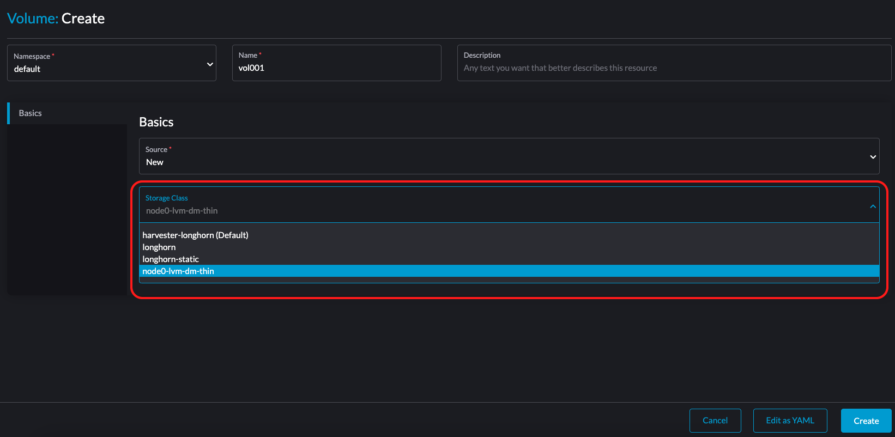

1. On the **Virtual Machines** screen, select the target virtual machine, and then select **⋮** > **Add Volume**.

    :::note

    Because the LVM volume is a local volume, you must ensure that the target node of the LVM StorageClass is the node on which the virtual machine is scheduled.

    :::

1. Specify the volume that you want to attach.

    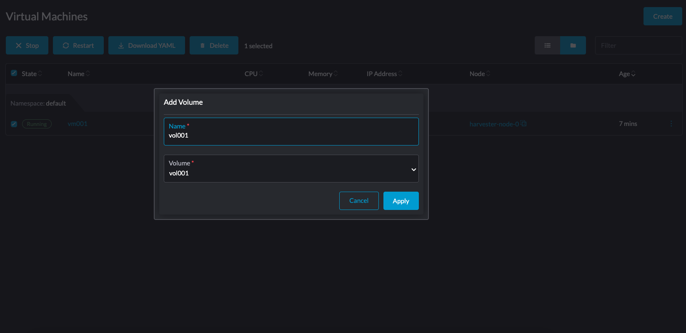

1. On the **Volumes** screen, verify that the state is **In-use**.

    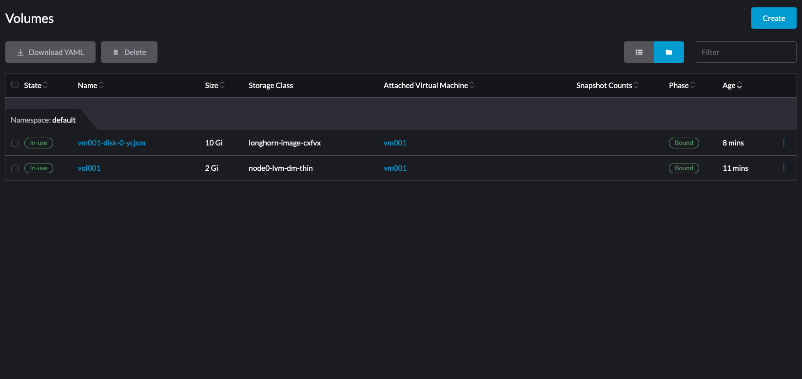

You can also create a new virtual machine with the volume of the LVM StorageClass that you created. This virtual machine will be scheduled on the target node with local storage for the volume.

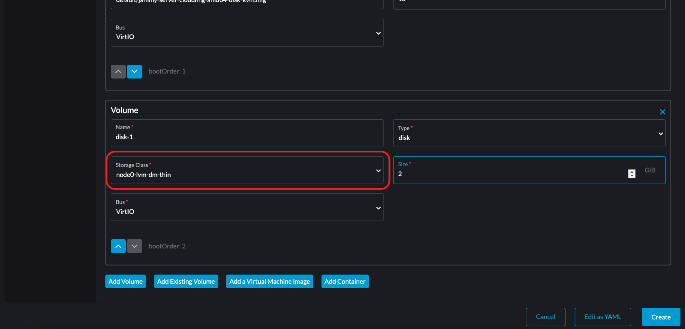

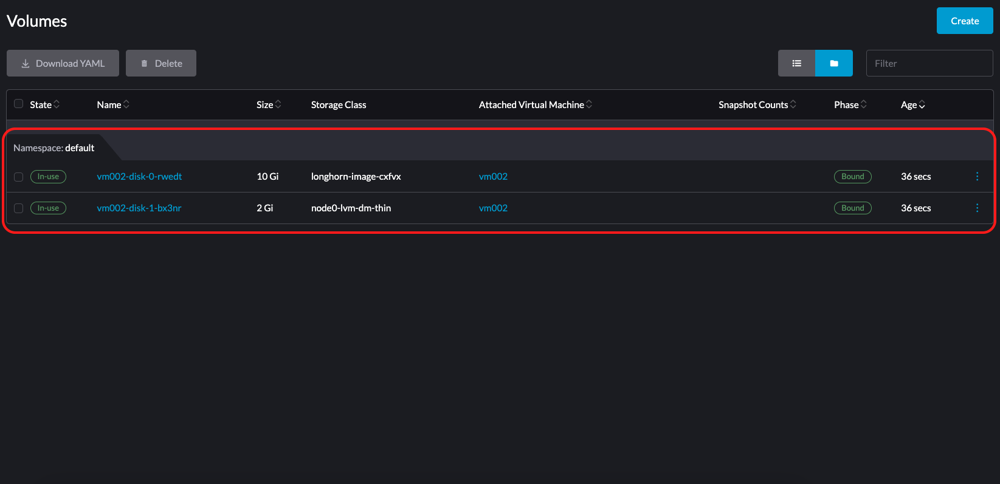

## Creating Snapshots for an LVM Volume

:::caution

The LVM StorageClass must use `volumeBindingMode: Immediate`.

If set to `WaitForFirstConsumer`, restoring a VM snapshot will fail due to a deadlock:
Harvester waits for the restored PVC to bind before starting the VM, while the PVC binding waits for the VM to start.

This is a [known issue (#10665)](https://github.com/harvester/harvester/issues/10665).

:::

1. On the Harvester UI, go to the **Settings** screen.

1. In the **csi-driver-config** section, select **⋮** > **Edit Setting**.

    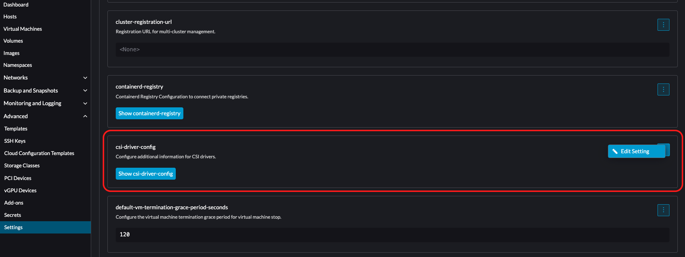

1. Add an entry with the following settings:

    - **Provisioner**: Select **lvm.driver.harvesterhci.io**.
    - **Volume Snapshot Class Name**: Select **lvm-snapshot**.

    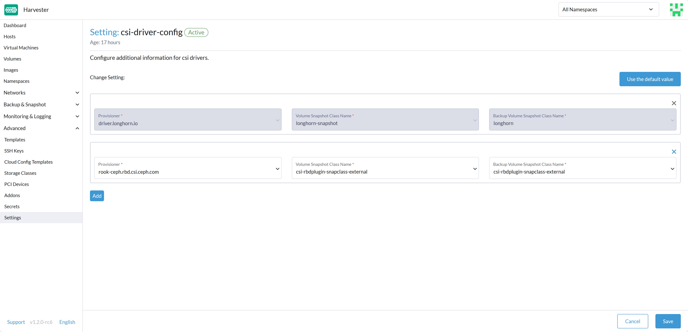

1. On the **Virtual Machines** screen, select the target virtual machine, and then select **⋮** > **Take Virtual Machine Snapshot**.

    Example:

    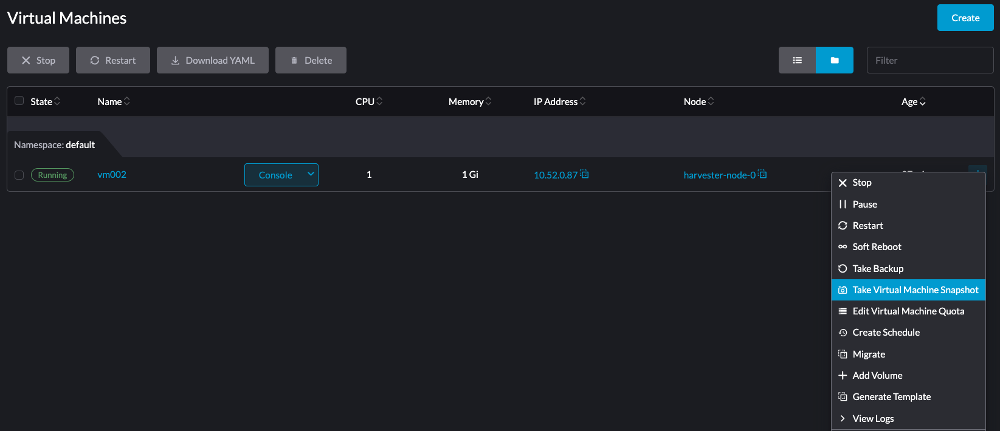

1. On the **Virtual Machine Snapshots** screen, verify that snapshot is ready to use.

    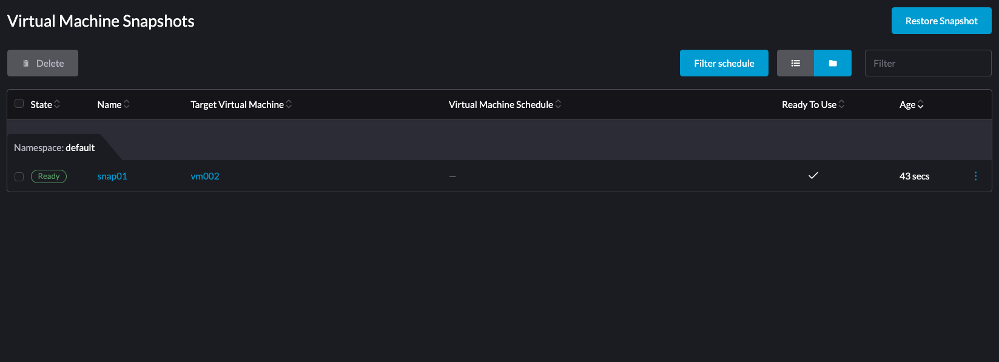

## Monitoring and Workload Planning

Monitor each thin pool directly on the node hosting its volume group. Run the following command to display data and metadata usage, read-only status, and health attributes:

```
sudo lvs -a <volume-group> \
  -o lv_name,lv_attr,data_percent,metadata_percent
```

### Monitoring Metrics and Volume Attributes

The command's output includes the following key fields:

- `Data%` (`-o data_percent`): Percentage of data LV space currently used by thin volumes.
- `Meta%` (`-o metadata_percent`): Percentage of metadata LV space currently used by the `dm_thin_pool` kernel module.
- `lv_attr`: 10-character status string. For thin pools, inspect the following bit positions:
    - Second character (write permissions):
        - `w`: The logical volume is writable.
        - `r`: The logical volume is read-only.
    - Ninth character (thin-pool health):
        - `F`: The thin pool has failed.
        - `D`: The thin pool has exhausted its available data space.
        - `M`: The thin-pool metadata is in read-only mode.

Monitor `Data%` and `Meta%`, and take corrective action before either value reaches 100%. Exhausting thin-pool data or metadata can stall or fail I/O operations and block volume and snapshot creation. These behaviors are inherent to Linux device-mapper thin provisioning. For more information, see the [LVM thin provisioning](https://www.man7.org/linux/man-pages/man7/lvmthin.7.html) man page.

### Workload Planning and Concurrency

Avoid overwhelming LVM storage with concurrent I/O-intensive workloads or simultaneous volume lifecycle operations (such as provisioning, cloning, snapshotting, and restoring). High resource contention increases latency and can cause application timeouts.

Optimal concurrency depends on your underlying storage hardware and workload I/O profiles. Validate your target concurrency levels through representative benchmark testing before deploying to production.

## Supported LVM Volume Features

- Volume resizing
- Volume cloning
- Snapshot creation

:::note

Backup creation is currently not supported. This limitation will be addressed in a future release.

:::
