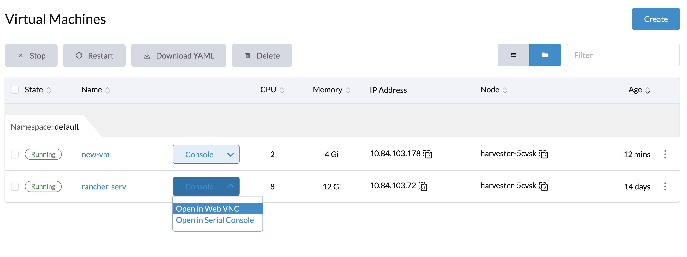
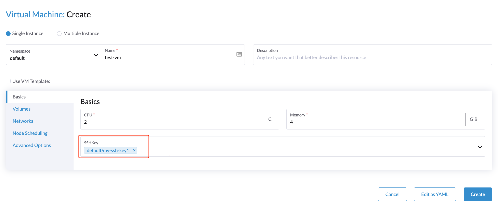
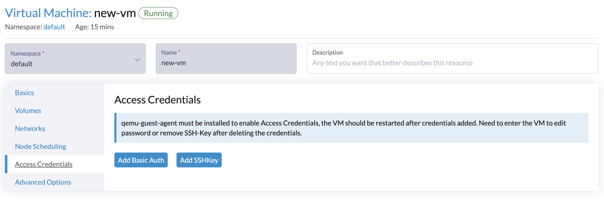

<head>
  <link rel="canonical" href="https://docs.harvesterhci.io/v1.9/vm/access-to-the-vm"/>
</head>

Once the VM is up and running, you can access it using either the Virtual Network Computing (VNC) client or the serial console from the Harvester UI.

Additionally, you can connect directly from your computer's SSH client.

## Access with the Harvester UI

VMs can be accessed from the UI directly using either VNC or the serial console.

If the VGA display is not enabled on the VM, e.g., the `Ubuntu-Minimal-Cloud` image, the VM can only be accessed with the serial console.



### VNC Console

The VNC console opens in a new browser window, which is titled with the virtual machine's name. The toolbar contains the following:


- **Connection Status**: For example, **Connecting…**, **Connected**, or **Disconnected**. To open a new connection to the console, select **Connected**, and then select **Reconnect**. When the console is disconnected, **Reconnect** is displayed next to the status.
- **View only**: Shows the display without sending your keyboard and mouse input to the virtual machine. While this checkbox is selected, **Shortcut keys**, **Ctrl+Alt+Del**, and **Soft reboot** are disabled.
- **Shortcut keys**: Sends key combinations that your browser or operating system would otherwise intercept. For more information, see [Sending Key Combinations](#sending-key-combinations).
- **Ctrl+Alt+Del**: Sends Ctrl+Alt+Del after you confirm. Windows opens its sign-in or security screen, while most Linux systems restart the virtual machine.
- **Soft reboot**: Sends a graceful restart signal to the guest operating system after you confirm. Unsaved work inside the virtual machine may be lost if the operating system shuts down without prompting the user. This button is displayed only when the virtual machine supports soft reboot.
- **View**: Contains the display options, which are saved in your browser.
  - **Scaling**: **Automatic** scales the display to fit the window. **Manual** allows you to set the **Zoom level** (50% to 200%).
  - **JPEG quality** and **Compression**: Balance image quality against network bandwidth.
  - **Reset to defaults**: Restores the default display options.
- **Full screen**: Shows the console in full screen, with a smaller toolbar that contains the virtual machine's name, the connection status, **Shortcut keys**, and **Exit full screen**. In Chromium-based browsers, shortcuts such as Ctrl+W and F11 are sent to the virtual machine instead of the browser.

A ring is displayed around the console while it has keyboard focus. The console receives focus automatically when it connects.

#### Sending Key Combinations

The **Shortcut keys** menu sends key combinations that your browser or operating system would otherwise intercept. The menu contains the following:


- **Your shortcuts**: The custom shortcuts that you saved. For more information, see [Saving Custom Shortcuts](#saving-custom-shortcuts).
- **Hold modifiers**: Sends **Ctrl**, **Alt**, or both together with the next key that you select. The keys in the menu change to match. For example, select **Ctrl** and **Alt**, and then select **Del** to send Ctrl+Alt+Del.
- **Keys** and **Function keys**: Sends Print Screen and the function keys F1 to F12.
- **Manage custom shortcuts**: Opens the **Custom shortcuts** dialog.

#### Saving Custom Shortcuts

You can record your own key combinations and send them with one click. Custom shortcuts are saved in your user account, so they are available in any browser that you log in from.

To save a custom shortcut, perform the following steps:

1. On the toolbar, select **Shortcut keys** > **Manage custom shortcuts**.

2. Click the **Key combination** field, and then press the key combination.

    Combinations that your browser or operating system reserves, such as Ctrl+Alt+Del or Ctrl+W, cannot be recorded. To send them, use **Hold modifiers** in the **Shortcut keys** menu.

3. (Optional) Specify a name for the shortcut.

    

4. Click **Add shortcut**.

    The shortcut is saved immediately and is displayed under **Your shortcuts** in the **Shortcut keys** menu.

5. Click **Done**.

To delete a custom shortcut, open the **Custom shortcuts** dialog, and then click the trash can icon next to the shortcut under **Saved shortcuts**.

#### Console in Use

_Available as of v1.10.0_

Only one VNC session can be connected to a virtual machine at a time. If someone else is using the console, Harvester does not disconnect them. Instead, the message **This console is in use** is displayed.


- **Reconnect**: Tries to connect again. Use this option after the other session is closed.
- **Take over**: Disconnects the other session and connects yours after you confirm. The disconnected session will not automatically retake control. Instead, it periodically retries in the background and will reconnect only when the active session is released.

:::note

**Take over** requires the Harvester cluster to be running v1.7.0 or later. While the "Console in Use" message is a UI feature introduced in v1.10.0, the backend takeover capability relies on this minimum cluster version. If you use Rancher to manage a Harvester cluster older than v1.7.0, the console connects without checking if it is in use, and any new session will automatically disconnect the existing one.

:::

## SSH Access

Harvester provides two ways to inject SSH public keys into virtual machines. Generally, these methods fall into two categories. [Static key injection](#static-ssh-key-injection-via-cloud-init), which places keys in the cloud-init script when the virtual machine is first powered on; [dynamic injection](#dynamic-ssh-key-injection-via-qemu-guest-agent), which allows keys or basic auth to be updated dynamically at runtime.

### Static SSH Key Injection via cloud-init

You can provide ssh keys to your virtual machines during the creation time on the `Basics` tab. Additionally, you can place the public ssh keys into your cloud-init script to allow it to take place.



#### Example of SSH key cloud-init configuration:
```yaml
#cloud-config
ssh_authorized_keys:
  - >-
    ssh-rsa #replace with your public key
```

### Dynamic SSH Key Injection via Qemu guest agent

_Available as of v1.0.1_

Harvester supports dynamically injecting public ssh keys at run time through the use of the [qemu guest agent](https://wiki.qemu.org/Features/GuestAgent). This is achieved through the `qemuGuestAgent` propagation method.

:::note

This method requires the qemu guest agent to be installed within the guest VM.

When using `qemuGuestAgent` propagation, the `/home/$USER/.ssh/authorized_keys` file will be owned by the guest agent. Changes to that file that are made outside of the qemu guest agent's control will get deleted.

:::

You can inject your access credentials via the Harvester dashboard as below:

1. Select the VM and click `⋮` button.
2. Click the `Edit Config` button and go to the `Access Credentials` tab.
3. Add either basic authentication credentials or SSH keys.
  You can only add a user that already exists in the guest operating system. For example, if you are using openSUSE, you can add the user `opensuse` and select SSH keys.
4. Make sure your qemu guest agent is already installed and the VM should be restarted after the credentials are added.

:::note

You need to enter the VM to edit password or remove SSH-Key after deleting the credentials from the UI.

:::




### Access with the SSH Client
Once the VM is up and running, you can enter the IP address of the VM in a terminal emulation client, such as PuTTY. You may also run the following command to access the VM directly from your computer's SSH client:

```
 ssh -i ~/.ssh/your-ssh-key user@<ip-address-or-hostname>
```
