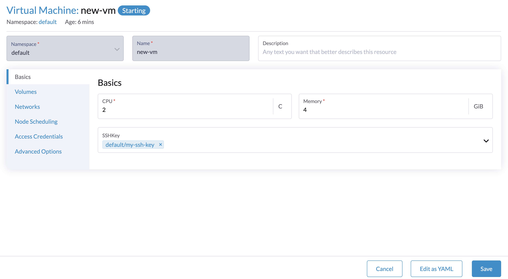
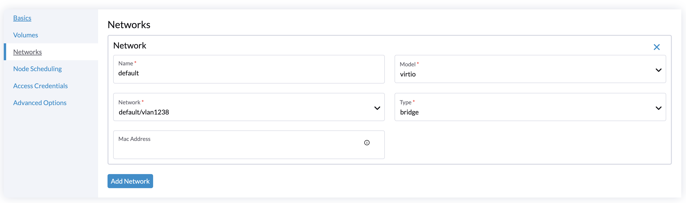
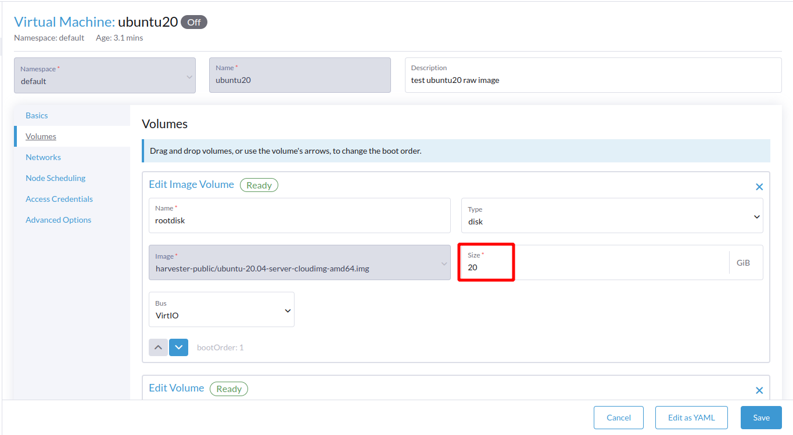

<head>
  <link rel="canonical" href="https://docs.harvesterhci.io/v1.9/vm/edit-vm"/>
</head>

## How to Edit a VM

After creating a virtual machine, you can edit your virtual machine by clicking the `⋮` button and selecting the `Edit Config` button.

:::note

In addition to editing the description, a restart of the virtual machine is required for configuration changes to take effect.

:::

### Basics

On the basics tab, you can config your requested CPU and memory, a VM restart is required for this configuration to take effect.

SSH Keys are injected into the cloud-init script when the virtual machine is first powered on. In order for the modified ssh key to take effect after the virtual machine is startup, the cloud-init script needs to be [reinstalled](../faq.md#how-to-install-the-qemu-guest-agent-of-a-running-vm) from your guest OS.



### Networks

You can add additional VLAN networks to your VM instances after booting, the `management network` is optional if you have the VLAN network configured.

Additional NICs are not enabled by default unless you configure them manually in the guest OS, e.g. using [wicked for your OpenSUSE Server](https://doc.opensuse.org/documentation/leap/reference/html/book-reference/cha-network.html#sec-network-manconf) or [netplan for your Ubuntu Server](https://ubuntu.com/server/docs/network-configuration).

If the virtual machine has one interface connected to the `mgmt` network and another connected to a different network (such as a VLAN), the node may be unable to reach the virtual machine's `mgmt` IP address. This connection issue occurs when the other network's gateway overrides the virtual machine's default route, resulting in routing that prefers the VLAN network for all inbound and outbound traffic, even traffic destined for the `mgmt` network.



For more details about the network implementation, please refer to the [Networking](../networking/harvester-network.md) page.

### Change the Network of a Running Virtual Machine

_Available as of v1.10.0_

You can move an existing network interface of a running virtual machine (VM) to a different VM Network without restarting the virtual machine. For example, you can move a workload from VLAN 100 to VLAN 200. Harvester applies the change by live-migrating the VM. The target `virt-launcher` pod attaches to the new network, and the guest OS continues running.

To change the network using the web UI:

1. On the **Virtual Machines** screen, locate the running virtual machine and select **⋮ > Edit Config**.
2. Go to the **Networks** tab and select a different **Network** for the interface.
    
    An informational message indicates when the change can be applied using live migration.
3. Click **Save**.

   The restart confirmation dialog is bypassed. The virtual machine transitions to the **Migrating** state temporarily, and then returns to the **Running** state on the new network.

The change is applied without a restart only when all of the following conditions are met:

- The virtual machine is [live-migratable](./live-migration.md#live-migratable-virtual-machines).
- Both the source and destination networks are VLAN (bridge) networks.
- Only the network binding of existing interfaces is modified. The interface name, model, type, and MAC address remain unchanged, and no other VM configuration settings are modified.

In all other cases, Harvester prompts you to restart the virtual machine, and the change takes effect after the restart. The following changes always require a restart:

- Moving an interface between a VLAN network and an [overlay network](../networking/harvester-network.md#overlay-network-experimental) in either direction. The interface type changes between `bridge` and `managedtap`, which cannot be altered while the virtual machine is running.
- Changing the `mgmt` (management) network.
- Modifying SR-IOV or PCI passthrough interfaces.

:::note

- The guest operating system does not receive notification that the underlying network changed. The MAC address and the interface name inside the guest remain unchanged. If the new network uses a different subnet, renew the DHCP lease or reconfigure the static IP address inside the guest after migration.
- The target node must be attached to the cluster network that hosts the new VM Network. If no eligible node can host the virtual machine on the new network, the migration does not start.
- If the virtual machine cannot be live-migrated, Harvester saves the configuration change and applies it the next time the virtual machine restarts.

:::

You can also update the network using `kubectl` by modifying `spec.template.spec.networks[].multus.networkName`:

```bash
kubectl -n default patch vm my-vm --type=json \
  -p '[{"op": "replace", "path": "/spec/template/spec/networks/0/multus/networkName", "value": "default/vlan200"}]'
```

KubeVirt sets the `MigrationRequired` condition on the virtual machine instance and creates a `VirtualMachineInstanceMigration` named `kubevirt-workload-update-<suffix>`. If the virtual machine gets the `RestartRequired` condition instead, the change cannot be applied while the virtual machine is running.

### Volumes

You can add additional volumes to the VM after booting. You can also expand the size of the volume after shutting down the VM, click the VM and go to the `Volumes` tab, edit the size of the expanded volume. After restarting the VM and waiting for the resize to complete, your disk will automatically finish expanding.

:::note

If you are using external storage, ensure that the storage provider supports volume expansion before you resize volumes.

:::



### Access Credentials

Access Credentials allow you to inject basic auth or ssh keys dynamically at run time when your guest OS has QEMU guest agent installed.

For more information, see [Dynamic SSH Key Injection via Qemu guest agent](./access-to-the-vm.md#dynamic-ssh-key-injection-via-qemu-guest-agent).

## Applying Changes

After modifying the configuration, you must save your changes. Harvester provides two options for applying them:

- `Save and Restart`: Applies the changes and restarts the virtual machine immediately.
- `Save`: Saves the new configuration without restarting. The changes will remain pending and will not take effect until the VM is manually restarted.

The restart dialog is not displayed when the only change is the network of an interface on a running, live-migratable virtual machine. For more information, see [Change the Network of a Running Virtual Machine](#change-the-network-of-a-running-virtual-machine).


### Pending Changes Notification

If you choose to delay the restart, a warning notification will appear on the Virtual Machines listing page to remind you which VMs have pending configuration changes.


